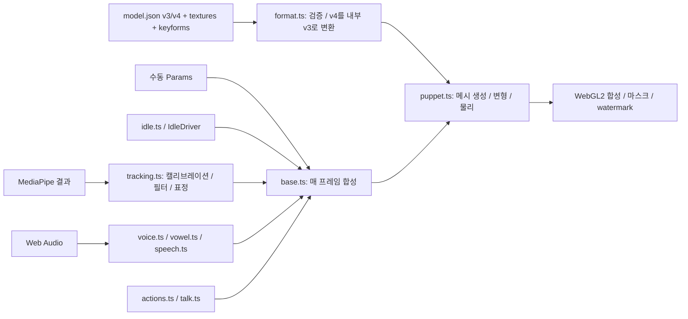

# LivLiv → Unity 포팅 조사·계획

현재 기준: 2026-11-09, `livliv-dev/player` 0.3.0 / `d999dea88981124168f9e9ab948eda8d2f23c453`.
로컬 fork의 `origin`은 `cody-yun/player`다. 이 문서에서 **upstream**은 `livliv-dev/player`를 뜻한다.
초기 조사 기준은 `011b1f5`였다. 이후 Git fetch로 확인한 표현식 label 타입 수정까지 검토·반영했다.
실제 업데이트 차이, fixture 결과 불변과 검증 범위는 [UPSTREAM.md](UPSTREAM.md)에 기록한다.

## 목표와 1:1 대응의 의미

LivLiv 2.5D 모델을 Unity에서 렌더링하고, 웹캠 얼굴 추적과 음성 립싱크로 조작한다.
원본 파일 경계·파라미터 이름·상수·계산 순서·기본값·좌표 규약을 유지하여 upstream 변경을 추적한다.
브라우저 API를 C#에 흉내내는 것이 아니라, 플랫폼 I/O만 별도 어댑터로 구현한다.

- `src/runtime/foo.ts` → `unity/Packages/ai.livliv.player/Runtime/runtime/foo.cs`.
- `src/foo.ts` → `unity/Packages/ai.livliv.player/Runtime/foo.cs`.
- 원본은 그대로 유지한다. Unity 추가 파일은 `unity/`, `scripts/unity/`, `tools/Parity/`, `docs/unity/` 아래에 둔다.
- JS `Number` 계산은 C# `double`, `Float32Array` 저장은 `float[]`로 대응한다. GPU에 제출할 때만 Unity float 자료형으로 변환한다.
- C# 메서드는 PascalCase로 옮기되 데이터 필드/파라미터 이름은 원본 이름을 유지한다.
- 원본 파일 하나가 커도 초기에 임의로 재설계하지 않는다. Unity 전용 작업만 `Platform/` 또는 별도 어셈블리로 분리한다.
- 변경된 원본을 새 기준으로 승인할 때만 manifest와 fixture를 다시 생성한다. 해시를 자동으로 갱신해 불일치를 숨기지 않는다.

## 조사 결과

원본 TypeScript는 총 5,852줄, 25개 모듈이다. 중심 렌더러 `runtime/puppet.ts`는 2,048줄이다.
외부 WebGL/렌더링 라이브러리 없이 메시 변형과 합성을 직접 처리한다.
공통 API의 VRM/PNGTuber는 별도 body 구현이며, 초기 LivLiv 렌더러의 선행 의존성이 아니다.

### 캐릭터 제작과 재생의 경계

2026-11-09 원본 README/FORMAT과 LivLiv 공개 웹 화면을 확인했다.
이 `player` 저장소는 재생 런타임이며 AI 캐릭터 제작·레이어 분리 서비스의 구현은 포함하지 않는다.
현재 Unity 포팅의 입력은 완성된 LivLiv 모델 패키지다.

1. [새 캐릭터 화면](https://livliv.ai/discover?new=1)에서 artwork 업로드 또는 텍스트 설명으로 제작한다. 현재 UI는 정면 반신 그림을 권장한다.
2. 생성 결과의 눈·입·고개 동작을 확인한다. 그림 품질과 제작된 rig/keyforms 품질은 플레이어 이식 품질과 별개다.
3. 원본 README가 안내하는 캐릭터 페이지의 **Model package**로 `.livliv`를 내보낸다.
4. `.livliv` 또는 압축을 푼 `model.json` + `textures/` + 선택적 `keyforms.json`을 Unity 모델 로더로 전달한다.
   현재 샘플 UI의 사용자 파일 선택기는 아직 없으며 ModelPackage/LoadAsync API 경로를 사용한다.

[개발자 페이지](https://livliv.ai/developers)는 character sheet → rigged model + layered PSD의 생성 API를 안내하지만 현재 **private beta**다.
PSD 내보내기는 별도의 편집/Live2D 작업 경로다. 이 Player가 `.psd`, `.moc3`, `.cmo3`를 직접 재생하는 것은 아니다.
포맷은 공개되어 별도 제작기에서도 호환 패키지를 작성할 수 있지만 PNG 한 장만 이름을 바꾼 패키지로는 동작하지 않는다.
레이어 텍스처, 앵커/rig, 눈·입 프레임과 필요시 키포즈 변형 데이터가 필요하다.
원본 Player의 VRM/PNGTuber 입력은 별도 기능이며 Unity 포트에서는 아직 그 경로가 구현되지 않았다.

### 실제 실행 흐름

`PlayerBase.draw()`는 사용자 params → idle → 등록 driver 순서 → action offset → smile/away → 범위 제한 → expression easing → show 순서다.
매 프레임 누적 pose를 계속 수정하면 action/idle 값이 누적되는 오류가 생기므로 이 순서도 포팅 대상이다.
`FaceTracker`가 얼굴을 0.4초 이상 잃으면 host가 idle로 돌려보낸다. tracker의 마지막 target 자체를 0으로 지우는 동작은 아니다.

### 모델과 렌더러에서 보존할 항목

| 영역 | 원본 계약 | Unity 대응 / 검증 |
|---|---|---|
| 모델 | v3 `livemaker-puppet`, v4 `livliv-model`; v4를 내부 v3로 lowering | 원본 readModel/validate 기준, 알려지지 않은 필드와 requires 처리도 대응 |
| 좌표 | 그림 좌상단 원점, Y 아래; 눈 L/R은 이미지 기준 | CPU 계산은 그대로, 출력 경계에서 Y 반전; 카메라 mirror는 별도 |
| 메시 | 모든 레이어가 동일한 model-pixel lattice 사용 | CPU 격자/indices부터 수치 비교; Mesh indexFormat은 UInt32 |
| 변형 | head bulge/parallax, head/body blend, 눈·입·눈썹·jaw | 정지 pose와 극단 pose에서 vertices 비교 |
| 합성 | 명시적 draw order, alpha, 눈 흰자 mask, iris soft clipping | 투명 RenderTexture + 순서 보장 draw; 단순 SpriteRenderer 교체로 동등성을 가정하지 않음 |
| 입 | amplitude threshold + hysteresis + hold, round/wide vowel | 원본 stepMouth 시퀀스 fixture로 검증 |
| 물리 | hair springs, body lag/bust, rig chains | 동일 dt 시퀀스와 reset/poke 비교 |
| keyforms | base64 int16 field, optional uint8 mask, linear/Hermite | byte decoding, 샘플링, 보간 수치 검증 |
| 이미지 | WebP/PNG, straight alpha 파일; 런타임 premultiplication | Unity 디코더 경계 명시. WebP는 별도 libwebp 1.6.0 macOS ARM64 플러그인; PNG는 Unity 디코더 |
| 패키지 | folder 또는 ZIP `.livliv`, 경로/중복/크기 제한 | 원본 제한 유지; 해제 전 validation, 취소/실패 시 리소스 반환 |
| 표기 | meta.author/license/watermark | 원본 메타데이터 보존, 요청된 mark를 렌더 결과에도 합성 |

셰이더 이식 시 WebGL 텍스처 업로드의 premultiplication, Unity linear/gamma, 텍스처 Y 방향,
RenderTexture 색공간, blend state를 함께 비교해야 한다. 첫 렌더 목표는 내장 파이프라인의 독립 출력이다.
URP/HDRP에 넣는 표시 계층은 이후 확장한다. 정적 합성의 순서/alpha/stencil은 synthetic 픽셀 테스트로 확인했다. 원본 캐릭터의 GPU 이미지 동등성은 아직 검증하지 않았다.

### 파일별 포팅 지도

아래는 목표이며 구현 상태는 [compatibility.json](../../unity/Packages/ai.livliv.player/compatibility.json)이 기준이다.

| 원본 | 책임 | Unity 플랫폼 경계 |
|---|---|---|
| `runtime/params.ts` | 15 parameters/ranges/smooth | 없음 |
| `runtime/filters.ts` | One Euro | 없음 |
| `runtime/actions.ts` | action curves/away | 없음 |
| `runtime/vowel.ts` | spectrum cue/FFT/clip track | 없음 |
| `runtime/voice.ts` | RMS/gate/AGC/attack/release | Microphone/AudioClip/필터/spectrum |
| `runtime/tracking.ts` | pose/blendshape/calibration/smoothing | Face Landmarker, 카메라, 보정값 저장 |
| `runtime/trace.ts` | frame contract/replay/recorder/stats | 녹화 파일 저장/진단 표시 |
| `runtime/format.ts` | v3/v4 read/validate/limits | JSON 파서 |
| `runtime/puppet.ts` | rig/mesh/physics/renderer | Unity Mesh/Texture/Material/CommandBuffer |
| `runtime/idle.ts` | lively idle/attention | pointer 좌표 어댑터 |
| `runtime/talk.ts` | syllable motion/bounce | 재현 가능한 RNG 주입 경계 |
| `runtime/speech.ts` | audio envelope/streamed playback | AudioSource/AudioClip/DSP clock |
| `runtime/brand.ts` | logo geometry | Unity mark 합성 |
| `base.ts` | driver lifecycle/frame/expression/actions | MonoBehaviour clock, pause/dispose |
| `index.ts` | Player API/load/puppet binding | Unity Player component |
| `tracking.ts` | tracking driver/auto-away | 위 runtime tracker와 host 연결 |
| `voice.ts` | speech/mic driver/talk motion | 위 voice/speech와 host 연결 |
| `follow.ts` | 이동/scale/head follow | model-space move를 render view에 반영 |
| `zip.ts` | 패키지 해제/입력 제한 | .NET ZIP/안전한 asset resolver |
| `mark.ts` | watermark 출력 | Unity 합성 pass |
| `errors.ts` | 오류 code | 동일 code를 가진 예외 |
| `release.ts` | GPU/canvas 해제 | 지연/claim/terminal 상태는 release.cs; 명시적 RenderTexture 저장소 반환과 대상별 유실 알림은 Player.Release.cs. 공유 엔진 컨텍스트는 유지. [RELEASE.md](RELEASE.md) |
| `body.ts` | 공통 body player | LivLiv 후속 |
| `png.ts` | PNGTuber body | LivLiv 후속 |
| `vrm.ts` | VRM body | 별도 Unity VRM 어댑터; 초기 범위 밖 |

### 웹캠 추론 선택

원본은 `@mediapipe/tasks-vision` 1.1.1의 Face Landmarker를 VIDEO mode, face 1개,
blendshapes와 facial transformation matrices 활성 상태로 사용한다.
계산 코어가 받는 것은 **column-major 4×4 행렬**, `trace.ts`의 18 blendshape 순서,
랜드마크 `[10, 13, 14, 152]`의 x/y다. 임의의 Unity Quaternion/Euler 변환을 중간에 넣지 않는다.

1차 native 후보는 [homuler/MediaPipeUnityPlugin](https://github.com/homuler/MediaPipeUnityPlugin).
2026-11-09 README는 Unity ≥2022.3, MediaPipe 0.10.22, macOS ARM64/Intel과 Face Landmark Task를 명시한다.
macOS/Windows 배포 라이브러리는 CPU 추론이며 WebGL 빌드 지원은 표에 없다.
브라우저의 1.1.1 npm 패키지와 동일한 런타임으로 간주할 수 없다.

homuler 0.16.3 릴리스와 모델 해시를 고정했고 `WebCamTexture → FaceLandmarker → FaceFrame` 어댑터를 별도 UPM 패키지로 구현했다.
macOS ARM64 Editor CPU 사진 추론을 확인했다. [네이티브 증거/남은 범위](NATIVE-FACE.md).
모델을 앱에 포함하여 런타임 네트워크 의존성을 줄인다. 배포 파일·플랫폼 호환성은 도입 시 확인한다.
실장치 검증은 비대칭 눈 깜박임, 좌우/상하/roll, mirror 전환, 안경/좁은 눈,
얼굴 이탈/복귀, 캘리브레이션, 마이크와 동시 실행을 포함한다.

### 라이선스와 배포 자료

코드는 Apache-2.0이며 Unity 패키지에도 LICENSE와 NOTICE를 포함했다.
샘플 캐릭터는 코드 라이선스와 별개이고 비상업 조건 및 개별 출처가 있다.
기존 `characters/LICENSE.md`, `characters/CREDITS.md`를 유지하고 샘플을 Unity 패키지에 무조건 복제하지 않는다.
자동 렌더 fixture는 우선 직접 생성한 단순 PNG 레이어로 만들고, 기존 캐릭터 비교는 로컬 검증으로 수행한다.
원본 브랜드/워터마크는 FORMAT.md의 요청대로 출력한다.

## 단계별 구현과 완료 기준

| 단계 | 작업 | 완료 판정 |
|---|---|---|
| P0 | 조사, source map/hash, UPM 패키지, CLI project | 25개 source 모두 추적, 변경 감지 실패 경로 확인 |
| P1 | Params/filters/actions/vowel, voice/tracking 계산 코어, trace replay | 원본에서 생성한 fixture와 C# 비교 통과; Unity EditMode 컴파일·테스트 |
| P2 | format/zip/resource loader, static renderer | v3/v4/오류 계약, PNG/WebP 로드, 순서/alpha/eye-mask/mark 테스트; CLI PNG 출력 |
| P3 | puppet deform/physics/keyforms/mouth, idle/talk/base/index | vertices 및 deterministic motion 비교, neutral/turn/blink/talk 이미지 비교 |
| P4 | 웹캠/MediaPipe, mic/AudioClip, 공통 drivers | 실제 장치 + 녹화 trace, 장치 중지/재시작, 오디오 동시 입력 확인 |
| P5 | 샘플 scene, 패키지 사용법, 빌드/장기 회귀 | PC/Mobile/WebGL CLI build와 실제 실행·입력 smoke, 리소스 누수/프레임 시간, upstream update rehearsal |

전체 목표 플랫폼은 PC(Windows/macOS/Linux), Mobile(Android/iOS), WebGL이다. 세부 계약과 완료 게이트는 [PLATFORMS.md](PLATFORMS.md)를 따른다.
초기 개발/검증 환경은 macOS ARM64, 설치된 Unity **6000.3.14f1**이며 다른 플랫폼 지원 완료를 뜻하지 않는다. URP/HDRP 표시 계층은 별도 확장이다.
Unity 설치나 라이선스를 임의 변경하지 않는다. CLI는 실제 설치본 `unity 1.0.0-beta.8`의 도움말을 기준으로 사용한다.

## upstream 갱신 절차

1. fork의 origin과 upstream의 의미를 혼동하지 않는다. 필요하면 `git remote add upstream https://github.com/livliv-dev/player.git` 후 fetch한다.
2. `npm --prefix tools/UpstreamAudit ci --ignore-scripts` 후 `node scripts/unity/check-upstream.mjs --ref upstream/main`으로 새 파일/삭제/내용 변경, 간접 영향과 fixture 검토 목록을 확인한다. 이 명령은 read-only다.
3. mapping별 TypeScript diff를 확인하고 대응 C#과 필요한 플랫폼 어댑터를 수정한다.
4. 원본 테스트를 실행하고 새 기준에서 `generate-parity.mjs`로 fixture를 생성한다. 기대값을 C# 결과로 만들지 않는다.
5. C# numeric parity → Unity EditMode → GPU image comparison → 장치 smoke 순으로 검증한다.
6. 기준 commit/hash/status를 검토하여 명시적으로 갱신한다. 미구현 기능은 pending/partial을 유지한다.

보고서 계약과 실제 WAV 수정 전/후 리허설, .NET/Unity CLI 검증 결과는 [UPSTREAM.md](UPSTREAM.md)에 기록했다.

## 근거

- [원본 기준 커밋](https://github.com/livliv-dev/player/tree/011b1f54d62c189cee49f29d3427c6d22fafdffd), 로컬 `src/`·`API.md`·`FORMAT.md`·`FORMAT-v3.md`·`test/` 직접 조사.
- [Unity Editor CLI](https://docs.unity.com/en-us/engine/6000.0/manual/unity-editor/command-line-arguments/editor) — browser 확인. batchmode/executeMethod 기반 자동화.
- [Unity Test CLI](https://docs.unity.com/en-us/engine/6000.6/manual/programming-environment/test-framework-introduction/running-tests/run-tests-from-command-line) — Context7 공식 문서 확인. 실제 설치 환경은 위 버전으로 별도 고정.
- [MediaPipe Unity Plugin](https://github.com/homuler/MediaPipeUnityPlugin) — browser README 확인. 도입 전 릴리스·모델 파일 고정 필요.
